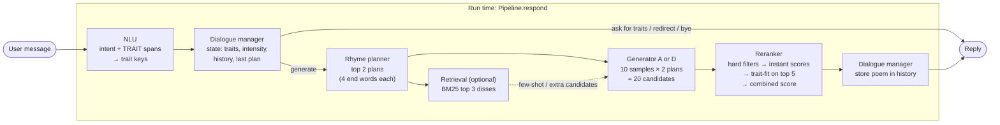
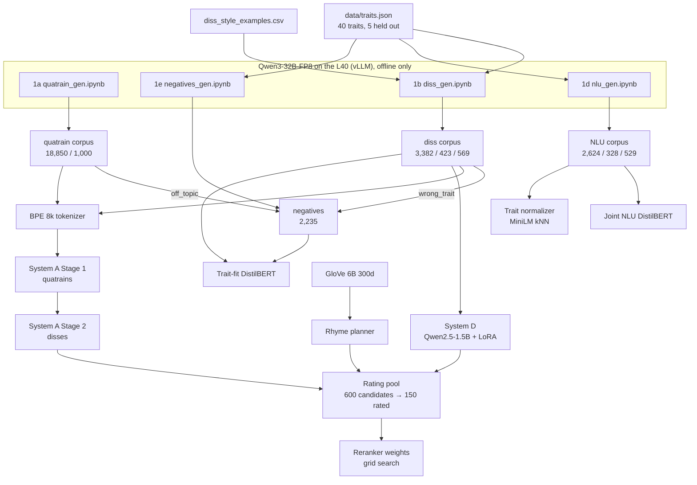

# Architecture and status

How the finished product is meant to fit together, and where each piece stands. The design is in [pipeline.md](pipeline.md); this file maps it to code. Status was checked against the repo on **2026-11-01** (branch `feat/phase0`, commit `7af65db`).

**Legend:** ✅ done · 🟡 partly done · ⬜ not started · ➖ optional, not planned unless there is time

---

## 1. The product in one picture

A user chats with the bot, names traits they're proud of, and gets back an AABB quatrain that roasts them. Everything at run time is local (no API calls).



The same chain as text:

```
message ─► NLU.parse ─► DialogueManager.step ─┬─► (no generation) canned reply
                                              └─► plan_rhymes ─► generator ─► Reranker.rank ─► reply
```

## 2. How the models are built (offline)



Phonetics (`phonetics/`, `data/form_checks.py`) sits under all of this: it filters every dataset, scores candidates in the reranker, and is the main metric in evaluation.

---

## 3. Components

| # | Component | Code | Inputs → outputs | Status |
|---|---|---|---|---|
| 0 | Config, seeds, paths | [config.yaml](config.yaml), [utils.py](utils.py) | | ✅ |
| 0 | Traits | [data/traits.json](data/traits.json) | 40 traits with `flip`, `synonyms`, `heldout` (eloquent, punctual, patient, worldly, frugal) | ✅ |
| 0 | Frozen eval prompts | [eval/prompts.json](eval/prompts.json) | 50 prompts (single / multi / held-out / unclear) | ✅ |
| 1a | Quatrain corpus | [data/quatrains/](data/quatrains/) | 20,000 generated → 18,850 train / 1,000 val (split by topic group) | ✅ |
| 1b | Diss corpus | [data/disses/](data/disses/) | 4,374 after filters → 3,382 / 423 / 569 (146 held-out in test) | ✅ (manual review skipped by design) |
| 1c | Rhyme-word annotation | in `prepare_*.py` | every diss/quatrain row has `end_words` and `rhymes` | ✅ |
| 1d | NLU data | [data/nlu/](data/nlu/) | 3,481 messages, 7 intents, BIO `TRAIT` | ✅ (spot check needs team confirmation) |
| 1e | Reranker negatives | [data/negatives/](data/negatives/) | 2,235 (flat, non_rhyming, off_topic, wrong_trait) | ✅ |
| 2 | Phonetic module | [phonetics/rhyme.py](phonetics/rhyme.py), [phonetics/scores.py](phonetics/scores.py) | `rhymes`, `aabb_score`, `syllable_score`, `lexical_score`, `form_scores` | ✅ (12 tests pass) |
| 2 | Rhyme planner | [phonetics/planner.py](phonetics/planner.py) | `plan_rhymes(traits, k, exclude)` → list of `[a1, a2, b1, b2]` | ✅ (fixed version, short common end words) |
| 3 | Tokenizer | [generation/tokenizer/](generation/tokenizer/) | sentencepiece BPE 8k with `<traits> <intensity> <rhymes> <poem> <nl>` | ✅ |
| 3 | System A: GRU LM | [generation/gru_lm.py](generation/gru_lm.py), [sequences.py](generation/sequences.py) | `generate(model, codec, traits, intensity, end_words, n)` | ✅ forward baseline + reversed-line final (`gen_A_rev_stage2_best.pt`) |
| 3 | System B: GRU enc-dec | | | ➖ not started |
| 3 | System C: small Transformer | | | ➖ not started |
| 3 | System D: Qwen2.5-1.5B + LoRA | [generation/qwen_lora.py](generation/qwen_lora.py) | `generate(model, tok, traits, intensity, end_words, n)` | ✅ 1.5B (`gen_D_1.5b_best/`); 0.5B / 3B size comparison ➖ |
| 4 | Retrieval (BM25) | [retrieval/](retrieval/) (empty) | `retrieve(traits, k=3)` | ➖ not started |
| 5 | Trait-fit classifier | [reranker/trait_fit.py](reranker/trait_fit.py) | `TraitFit.score(traits, poems)` → probabilities | ✅ test AUC 0.984, held-out 0.966 |
| 5 | Combined reranker | `reranker/rerank.py` (missing) | candidates → best poem | ⬜ |
| 5 | Weight tuning | [reranker/rating_pool.py](reranker/rating_pool.py) | 150 rated candidates → weights | 🟡 see §5 |
| 6 | Joint NLU | [nlu/joint_model.py](nlu/joint_model.py) | `NLU.parse(text)` → intent, spans, traits | ✅ intent acc 0.938 |
| 6 | Trait normalizer | [nlu/normalize.py](nlu/normalize.py) | span → trait key / unknown + nearest | ✅ (weakest step: 0.44–0.49 strict on gold spans) |
| 7 | Dialogue manager | [dialogue/](dialogue/) (empty) | `(nlu result, state)` → action + new state | ⬜ |
| 8 | Pipeline + Gradio UI | [app/](app/) (empty) | `Pipeline.respond(message, state)`, `gr.ChatInterface` | ⬜ |
| 8 | Run script + README | | one command to launch the demo | ⬜ |
| 9 | Automatic eval on 50 prompts | | main results table | ⬜ |
| 9 | Ablations | | with/without Stage 1, planner, reranker, retrieval; quality vs. candidates | 🟡 only A forward vs. reversed exists |
| 9 | Dialogue eval | | 20 scripted conversations | ⬜ |
| 9 | Human eval | | 30 prompts × 4 configs, 3–5 outside raters | ⬜ |
| 10 | Report and demo | | | ⬜ |

Checkpoints in `checkpoints/` (git-ignored, mirrored to Drive): `gen_A_*`, `gen_A_rev_*`, `gen_D_1.5b_best/`, `nlu_joint_best/`, `trait_fit_best/`. GloVe files are in `data/glove/` (git-ignored, built by `data/prepare_glove.py`).

---

## 4. Run-time flow in detail

What happens inside `Pipeline.respond(message, state)` once it exists. Steps marked ⬜ are the ones still to write.

1. **NLU** ✅ — `NLU.parse(message)` returns the intent, the `TRAIT` spans and their normalized trait keys. Spans one word apart are joined. A span below 0.4 similarity to everything comes back as unknown, with its nearest trait.
2. **Dialogue manager** ⬜ — updates `state = {traits, intensity, history, last_plan, awaiting}` and picks an action:

   | Intent / situation | Action |
   |---|---|
   | `request_diss` with traits | set traits → generate |
   | `request_diss` without traits | ask for traits (`awaiting = "traits"`) |
   | `another_one` | generate with the same state, avoid `history` and `last_plan` |
   | `make_meaner` / `make_softer` | set intensity to harsh / mild → generate |
   | new traits mid-conversation | add, or replace if the user says so |
   | unknown trait | use the nearest trait and say so, or a fallback diss (empty traits) |
   | `greet` / `goodbye` / `out_of_scope` | canned reply, redirect to purpose |

   Check meaner/softer keywords before trusting the intent head (`make_meaner` is the weakest intent, 0.77).
3. **Rhyme planner** ✅ — `plan_rhymes(traits, k=2, exclude=last_plan)`.
4. **Retrieval** ➖ — `retrieve(traits, k=3)` for few-shot examples in D's prompt and as extra candidates.
5. **Generator** ✅ — 10 samples per plan at temperature 0.8, top-p 0.9, repetition penalty 1.2, so about 20 candidates, each with its length-normalized log-probability. A forces the end words (reversed lines); D does not, so its rhyme depends on the reranker.
6. **Reranker** ⬜ (`TraitFit` ✅)
   - hard filters: exactly 4 lines, Detoxify limits from `config.yaml`, `lexical_score ≥ 0.8`
   - instant features on every survivor: `norm_logprob`, `aabb_score`, `syllable_score`, `lexical_score`, repetition, ROUGE-L > 0.5 against `history`
   - `TraitFit.score` on the top 5 only
   - `score = w1·logprob + w2·aabb + w3·syllable + w4·lexical + w5·trait_fit − w6·repetition − w7·toxicity`, features scaled within the request, `w3 = w2`
7. **Reply** ⬜ — format the four lines, append to `history`, store the plan as `last_plan`, add a note if a trait was guessed.

### Interfaces still to define

These are suggestions that match the code already there; rename freely.

```python
# reranker/rerank.py
class Reranker:
    def __init__(self, cfg, weights, trait_fit=None, toxicity=None): ...
    def rank(self, traits, candidates, history=()) -> list[dict]:   # candidates: {"lines", "norm_logprob", ...}

# dialogue/manager.py
class DialogueManager:
    def step(self, parsed, state) -> tuple[dict, dict]:   # (action, new_state); action: {"kind": "generate" | "say", ...}

# app/pipeline.py
class Pipeline:
    def __init__(self, cfg, system="D", device="cpu"): ...   # loads NLU, planner, generator, reranker once
    def respond(self, message, state) -> tuple[str, dict]: ...

# app/chat.py: gr.ChatInterface with a generator dropdown (A / D)
# eval/run_auto_eval.py: frozen prompts → eval/results/auto/{system}_{config}.json
```

---

## 5. Where things stand right now

### Reranker weight tuning (the item in progress)

| Step | Command | Status |
|---|---|---|
| Prompts with the fixed planner | `rating_pool.py prompts --force` | ✅ committed in `7af65db` |
| System A candidates | `rating_pool.py generate --system A` | ✅ committed (200) |
| System D candidates | `rating_pool_D.ipynb` on Colab | ✅ `candidates_D.jsonl` (400), **not committed** |
| Rating sheets | `rating_pool.py sheets --force` | ⚠️ **stale**: `sheets/`, `items.jsonl` and `sheets_meta.json` were built at 23:07, before the new prompts (23:22) and candidates. Only 3 of their 31 plans match the current prompts. Rebuild before anyone rates. |
| Ratings | two raters fill `rater_1.csv`, `rater_2.csv` | ⬜ (0 / 150 each) |
| Collect + agreement | `rating_pool.py collect` | ⬜ |
| Grid search | `reranker/rerank.py` | ⬜ |

A quick check of the new candidates with `aabb_score` (both couplets an exact rhyme):

| | Candidates | Full AABB | Line ends on planned word |
|---|---|---|---|
| A (fixed planner) | 200 | 100% | 100% |
| D (fixed planner) | 400 | 54% | 85% |

pipeline.md reports D at 49% with the old planner and 81% with real diss end words, so the planner fix helped D only a little. This is worth a look before rating: either the plans are still harder than real diss end words, or this count is stricter than the one in `eval/results/gen_D/`.

### Other open items

- **NLU spot check**: 348 rows in `data/nlu/corpus/spot_check.csv` were checked by Claude only (42 marked wrong); the team still has to confirm.
- **System checkpoint for Week 10** ("every system produces readable quatrains for the 50 evaluation prompts"): not yet run on `eval/prompts.json`. Note that those prompts carry `intensity: null`, so the eval needs a default.
- **Intensity values don't line up**: the dialogue sketch in pipeline.md starts at `"normal"`, but the generators only know `mild`, `harsh` (and `none` from Stage 1). Pick one default, probably `mild`, and use it in the dialogue manager and the eval.
- **`requirements.txt`** is missing packages the code already imports (`peft`, `scipy`) and ones the remaining phases need (`gradio`, and `rank_bm25` if retrieval is built).
- **Legacy files**: `Datasets/` (sonnets, old diss CSV) and `Train.ipynb` are from before the current pipeline and are not used by it. Archive or delete them before submission.
- **Untracked**: `data/rerank_ratings/candidates_D.jsonl`, and the stale sheets (which should be rebuilt rather than committed).

---

## 6. What's left, in order

The critical path to a demo-able product, then the evaluation the report needs.

1. **Rebuild the rating sheets** (`python reranker/rating_pool.py sheets --force`) with the current candidates; look at D's 54% AABB first.
2. **`reranker/rerank.py`**: hard filters, features, combined score, top-5 trait-fit. It can run with hand-set weights before the ratings come back.
3. **Rate, collect, grid search** → final weights into `config.yaml`.
4. **`dialogue/manager.py`**: the rule table in §4, keyword check for meaner/softer, repeat avoidance.
5. **`app/pipeline.py` + `app/chat.py`**: chain everything, Gradio UI with A/D dropdown, measure response time on CPU (A) and laptop GPU (D).
6. **Run script + README** for the "executable conditions" in the brief; fix `requirements.txt`.
7. **Automatic eval** on the 50 frozen prompts for A and D (rhyme, syllables, format, lexical, trait-fit, distinct-1/2, 4-gram memorization, perplexity, time).
8. **Ablations**: no Stage 1 (A), no planner (unconstrained end words), no reranker (first candidate), and quality against 5/10/20/40 candidates.
9. **Dialogue eval**: write 20 scripted conversations and score task success per turn.
10. **Human eval**: 30 prompts × 4 configs (A-base, A-full, D-base, D-full), 3–5 raters outside the team, Krippendorff's alpha and Wilcoxon tests, held-out traits reported apart.
11. **Report and demo.**

Optional, only if time allows: retrieval (Phase 4), Systems B and C, the D size comparison (0.5B / 3B), and an LLM second judge.
