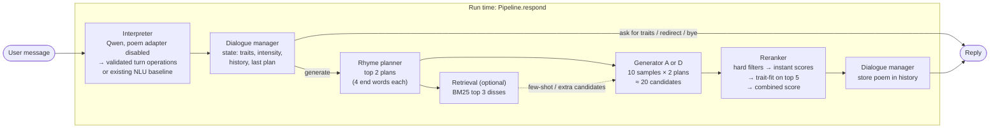
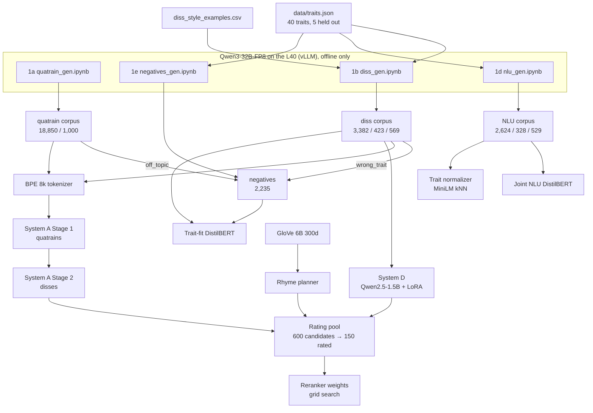

# Architecture and status

How the finished product is meant to fit together, and where each piece stands. The design is in [pipeline.md](pipeline.md); this file maps it to code. Updated **2026-11-01** after implementing the shared-Qwen dialogue path. Runtime quality and latency still require the external project checkpoints and GloVe assets; saved training metrics below were not rerun.

**Legend:** ✅ done · 🟡 partly done · ⬜ not started · ➖ optional, not planned unless there is time

---

## 1. The product in one picture

A user chats with the bot, names traits they're proud of, and gets back an AABB quatrain that roasts them. Everything at run time is local (no API calls).



The same chain as text:

```
message ─► interpreter.interpret ─► DialogueManager.step ─┬─► (no generation) canned reply
                                              └─► plan_rhymes ─► generator ─► Reranker.rank ─► reply
```

## 2. How the models are built (offline)



Phonetics (`phonetics/`, `data/form_checks.py`) sits under all of this: it filters every dataset, scores candidates in the reranker, and is the main metric in evaluation.

---

## 3. Components

| # | Component | Code | Inputs → outputs | Status |
|---|---|---|---|---|
| 0 | Config, seeds, paths | [config.yaml](config.yaml), [utils.py](utils.py) | | ✅ |
| 0 | Traits | [data/traits.json](data/traits.json) | 40 traits with `flip`, `synonyms`, `heldout` (eloquent, punctual, patient, worldly, frugal) | ✅ |
| 0 | Frozen eval prompts | [eval/prompts.json](eval/prompts.json) | 50 prompts (single / multi / held-out / unclear) | ✅ |
| 1a | Quatrain corpus | [data/quatrains/](data/quatrains/) | 20,000 generated → 18,850 train / 1,000 val (split by topic group) | ✅ |
| 1b | Diss corpus | [data/disses/](data/disses/) | 4,374 after filters → 3,382 / 423 / 569 (146 held-out in test) | ✅ (manual review skipped by design) |
| 1c | Rhyme-word annotation | in `prepare_*.py` | every diss/quatrain row has `end_words` and `rhymes` | ✅ |
| 1d | NLU data | [data/nlu/](data/nlu/) | 3,481 messages, 7 intents, BIO `TRAIT` | ✅ (spot check needs team confirmation) |
| 1e | Reranker negatives | [data/negatives/](data/negatives/) | 2,235 (flat, non_rhyming, off_topic, wrong_trait) | ✅ |
| 2 | Phonetic module | [phonetics/rhyme.py](phonetics/rhyme.py), [phonetics/scores.py](phonetics/scores.py) | `rhymes`, `aabb_score`, `syllable_score`, `lexical_score`, `form_scores` | ✅ (12 tests pass) |
| 2 | Rhyme planner | [phonetics/planner.py](phonetics/planner.py) | `plan_rhymes(traits, k, exclude)` → list of `[a1, a2, b1, b2]` | ✅ (fixed version, short common end words) |
| 3 | Tokenizer | [generation/tokenizer/](generation/tokenizer/) | sentencepiece BPE 8k with `<traits> <intensity> <rhymes> <poem> <nl>` | ✅ |
| 3 | System A: GRU LM | [generation/gru_lm.py](generation/gru_lm.py), [sequences.py](generation/sequences.py) | `generate(model, codec, traits, intensity, end_words, n)` | ✅ forward baseline + reversed-line final (`gen_A_rev_stage2_best.pt`) |
| 3 | System B: GRU enc-dec | | | ➖ not started |
| 3 | System C: small Transformer | | | ➖ not started |
| 3 | System D: Qwen2.5-1.5B + LoRA | [generation/qwen_lora.py](generation/qwen_lora.py) | `generate(model, tok, traits, intensity, end_words, n)` | ✅ 1.5B (`gen_D_1.5b_best/`); 0.5B / 3B size comparison ➖ |
| 4 | Retrieval (BM25) | [retrieval/](retrieval/) (empty) | `retrieve(traits, k=3)` | ➖ not started |
| 5 | Trait-fit classifier | [reranker/trait_fit.py](reranker/trait_fit.py) | `TraitFit.score(traits, poems)` → probabilities | ✅ test AUC 0.984, held-out 0.966 |
| 5 | Combined reranker | [reranker/rerank.py](reranker/rerank.py) | strict form/lexical/toxicity filters, history, top-5 trait fit → best poem | ✅ code + tests; weights provisional |
| 5 | Weight tuning | [reranker/rating_pool.py](reranker/rating_pool.py) | 150 rated candidates → weights | 🟡 see §5 |
| 6 | Joint NLU | [nlu/joint_model.py](nlu/joint_model.py) | `NLU.parse(text)` → intent, spans, traits | ✅ intent acc 0.938 |
| 6 | Trait normalizer | [nlu/normalize.py](nlu/normalize.py) | span → trait key / unknown + nearest | ✅ (weakest step: 0.44–0.49 strict on gold spans) |
| 7 | Dialogue manager | [dialogue/manager.py](dialogue/manager.py), [interpreter.py](dialogue/interpreter.py) | validated operations + session state → decision + new state | ✅ policy/mock integration tests; real parser evaluation pending |
| 8 | Pipeline + Gradio UI | [app/pipeline.py](app/pipeline.py), [app/chat.py](app/chat.py) | `Pipeline.respond(message, state)`, Gradio Blocks | ✅ implemented; UI constructed; project-model smoke pending |
| 8 | Run script + README | [README.md](README.md), `python -m app.chat` | asset setup and local launch | ✅ |
| 9 | Automatic eval on 50 prompts | | main results table | ⬜ |
| 9 | Ablations | | with/without Stage 1, planner, reranker, retrieval; quality vs. candidates | 🟡 only A forward vs. reversed exists |
| 9 | Dialogue eval | [eval/run_dialogue_eval.py](eval/run_dialogue_eval.py) | 22 frozen conversations / 57 turns; separate dev set | 🟡 gold-policy run passes; real-model runs pending |
| 9 | Human eval | | 30 prompts × 4 configs, 3–5 outside raters | ⬜ |
| 10 | Report and demo | | | ⬜ |

Checkpoints in `checkpoints/` (git-ignored, mirrored to Drive): `gen_A_*`, `gen_A_rev_*`, `gen_D_1.5b_best/`, `nlu_joint_best/`, `trait_fit_best/`. GloVe files are in `data/glove/` (git-ignored, built by `data/prepare_glove.py`).

---

## 4. Implemented run-time flow

1. **Interpret:** one shared `Qwen2.5-1.5B-Instruct` model and the existing unmerged poem LoRA adapter are loaded lazily. `app/model_service.py` serializes all Qwen access. Inside `model.disable_adapter()`, the model maps the original message, structured session state and the full 40-trait catalogue to validated JSON. The existing NLU remains selectable with `--backend nlu`.
2. **Validate:** `dialogue/types.py` rejects unknown fields, malformed flags/enums, invalid trait keys and contradictory operation combinations. One bounded retry is allowed. Repeated invalid output leaves state unchanged and returns a clarification. JSON validity does not imply semantic accuracy.
3. **Manage state:** `DialogueManager.step` applies ordered add/remove/replace operations, intensity changes and explicit generic requests. Default intensity is `mild`. Unknown descriptions stage their proposed changes until clarified; yes/no, choices, cancellation and fresh requests are handled explicitly. Reset clears only the current session.
4. **Plan:** `RhymePlanner.plan` supplies two plan dictionaries. The previous selected plan's words are excluded first; an empty result permits a bounded fallback without word exclusions. Candidate metadata retains each plan's end words.
5. **Generate:** System D uses the same Qwen model with its poem adapter restored. System A uses the existing GRU. Sampling remains 10 candidates per plan, temperature 0.8, top-p 0.9 and repetition penalty 1.2.
6. **Select:** the combined reranker requires four nonempty lines, exact AABB, lexical score ≥ 0.8 and the existing toxicity limits. It rejects exact history duplicates, penalizes repetition and ROUGE-L above 0.5, scales features within a request and scores trait fit on the top five. Weights are provisional until human tuning. Toxicity uses local Detoxify checkpoint weights and cached BERT configuration/tokenizer.
7. **Commit:** append only the selected valid poem, including generator, active settings, planned and actual end words. Persist its planned words as `last_plan`. One extra generation batch is allowed if selection is empty. Exhaustion preserves settings without changing successful history.

Session state is independent of shared models. The UI uses Gradio Blocks with a per-session state object and serialized callbacks; switching A/D preserves settings. Qwen interpretation still requires Qwen when System A writes the poem. `app/setup_assets.py` prepares public dependencies only when explicitly invoked with `--download`; inference uses local assets.

The catalogue is generated by `python -m dialogue.build_catalogue` from `data/traits.json` plus the poem **training** split. It includes 40 entries, 35 seen in fine-tuning and five held out. The prompt includes neutral descriptions and synonyms, not training flags or roast angles.

Entry points:

```python
# app/pipeline.py
pipeline = Pipeline(cfg, system="D", device="cpu")
reply, new_state = pipeline.respond(message, state)
```

```text
python -m app.chat --device cuda
python -m unittest discover -v
python -m eval.run_dialogue_eval --mode policy
python -m eval.run_dialogue_eval --mode interpreter --backend qwen --device cuda
python -m eval.run_dialogue_eval --mode integrated --system D --device cuda
```

See [README.md](README.md) for checkpoints, public caches and GloVe setup. The policy evaluation uses gold operations and mocked poem records, so its success is not a Qwen matching or poem-quality result. Real-checkpoint interpretation, integration, comparative quality and hardware latency remain unmeasured in this checkout.

---

## 5. Where things stand right now

### Reranker weight tuning (historical local run; assets must be restored here)

| Step | Command | Status |
|---|---|---|
| Prompts with the fixed planner | `rating_pool.py prompts --force` | ✅ committed in `7af65db` |
| System A candidates | `rating_pool.py generate --system A` | ✅ committed (200) |
| System D candidates | `rating_pool_D.ipynb` on Colab | Earlier run produced 400; file absent in this checkout |
| Rating sheets | `rating_pool.py sheets --force` | Absent here; older local sheets were stale. Rebuild with current candidates before rating. |
| Ratings | two raters fill `rater_1.csv`, `rater_2.csv` | ⬜ (0 / 150 each) |
| Collect + agreement | `rating_pool.py collect` | ⬜ |
| Grid search | planned tuning tool | ⬜; runtime ranking exists with provisional weights |

The earlier architecture audit reported these candidate checks with `aabb_score` (both couplets an exact rhyme); D cannot be reproduced from this checkout until its candidates are restored:

| | Candidates | Full AABB | Line ends on planned word |
|---|---|---|---|
| A (fixed planner) | 200 | 100% | 100% |
| D (fixed planner) | 400 | 54% | 85% |

pipeline.md reports D at 49% with the old planner and 81% with real diss end words, so the planner fix helped D only a little. This is worth a look before rating: either the plans are still harder than real diss end words, or this count is stricter than the one in `eval/results/gen_D/`.

### Other open items

- **NLU spot check**: 348 rows in `data/nlu/corpus/spot_check.csv` were checked by Claude only (42 marked wrong); the team still has to confirm.
- **System checkpoint for Week 10** ("every system produces readable quatrains for the 50 evaluation prompts"): not yet run on `eval/prompts.json`. Note that those prompts carry `intensity: null`, so the eval needs a default.
- **Intensity default resolved:** dialogue uses `mild`; runtime validation permits only `mild` and `harsh`. Frozen automatic poem-evaluation prompts still need their null intensities defaulted by that evaluator.
- **Dependencies updated:** `peft`, `scipy`, `safetensors` and Gradio are included, with compatible Transformers/PEFT/Gradio ranges. Retrieval would still need its own dependency if implemented.
- **Legacy files**: `Datasets/` (sonnets, old diss CSV) and `Train.ipynb` are from before the current pipeline and are not used by it. Archive or delete them before submission.
- **Rating assets in this checkout:** only A candidates and prompts are present. D candidates and rating sheets must be restored or regenerated before tuning; older local status notes above are historical.

---

## 6. Remaining work

1. Restore project checkpoints, public model caches and GloVe; run `python -m app.setup_assets`.
2. Run actual Qwen/NLU interpreter comparisons on the fixed dialogue fixtures, then complete A/D integrated conversations and measure CPU/GPU latency and memory.
3. Rebuild rating candidates/sheets as needed; rate, collect and tune the combined reranker's provisional weights.
4. Run the 50-prompt automatic generation evaluation and planned generator/reranker ablations.
5. Conduct outside-rater human evaluation, then complete the report and demo.

Retrieval, Systems B/C, new model sizes and new adapters remain optional. See [AGENTS.md](AGENTS.md) for the detailed implementation checklist and remaining model-dependent acceptance criteria.
