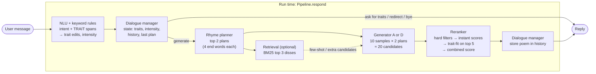
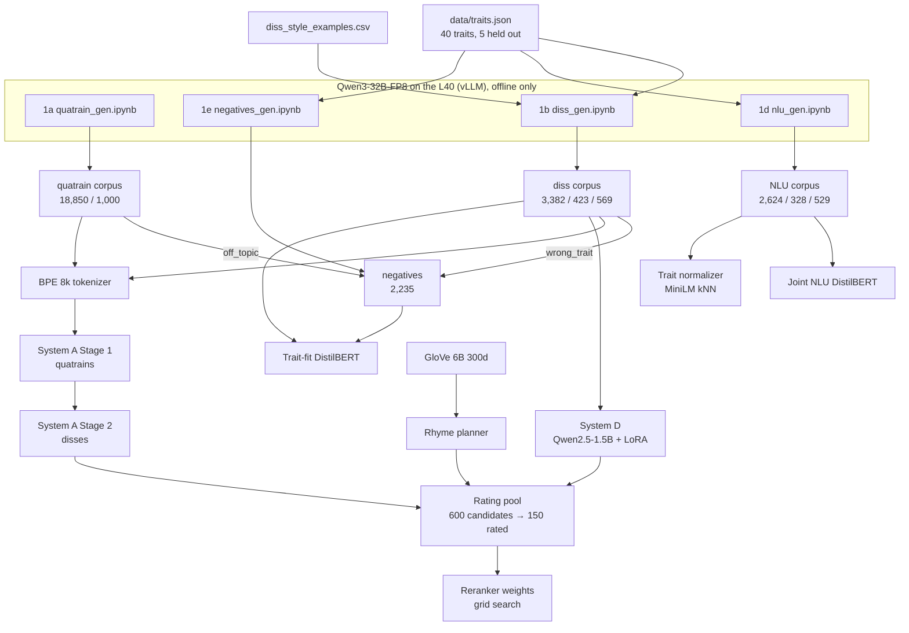

# Architecture and status

How the finished product is meant to fit together, and where each piece stands. The design is in [pipeline.md](pipeline.md); this file maps it to code. Status was checked against the repo on **2026-11-03** (branch `feat/dialogue-integration`: `feat/phase0` at `a7beb01` with the dialogue manager from `feat/phase0-david` merged in).

**Legend:** ✅ done · 🟡 partly done · ⬜ not started · ➖ optional, not planned unless there is time

---

## 1. The product in one picture

A user chats with the bot, names traits they're proud of, and gets back an AABB quatrain that roasts them. Everything at run time is local (no API calls).



The same chain as text:

```
message ─► NLUInterpreter.interpret ─► DialogueManager.step ─┬─► (no generation) canned reply / question
                                                              └─► RhymePlanner.plan ─► generator ─► Reranker.rerank ─► reply
```

## 2. How the models are built (offline)



Phonetics (`phonetics/`, `data/form_checks.py`) sits under all of this: it filters every dataset, scores candidates in the reranker, and is the main metric in evaluation.

---

## 3. Components

| # | Component | Code | Inputs → outputs | Status |
|---|---|---|---|---|
| 0 | Config, seeds, paths | [config.yaml](config.yaml), [utils.py](utils.py) | | ✅ |
| 0 | Traits | [data/traits.json](data/traits.json) | 40 traits with `description`, `flip`, `synonyms`, `heldout` (eloquent, punctual, patient, worldly, frugal); [data/trait_catalogue.json](data/trait_catalogue.json) adds training counts (`python -m dialogue.build_catalogue`) | ✅ |
| 0 | Frozen eval prompts | [eval/prompts.json](eval/prompts.json) | 50 prompts (single / multi / held-out / unclear) | ✅ |
| 1a | Quatrain corpus | [data/quatrains/](data/quatrains/) | 20,000 generated → 18,850 train / 1,000 val (split by topic group) | ✅ |
| 1b | Diss corpus | [data/disses/](data/disses/) | 4,374 after filters → 3,382 / 423 / 569 (146 held-out in test) | ✅ (manual review skipped by design) |
| 1c | Rhyme-word annotation | in `prepare_*.py` | every diss/quatrain row has `end_words` and `rhymes` | ✅ |
| 1d | NLU data | [data/nlu/](data/nlu/) | 3,481 messages, 7 intents, BIO `TRAIT` | ✅ (spot check needs team confirmation) |
| 1e | Reranker negatives | [data/negatives/](data/negatives/) | 2,235 (flat, non_rhyming, off_topic, wrong_trait) | ✅ |
| 2 | Phonetic module | [phonetics/rhyme.py](phonetics/rhyme.py), [phonetics/scores.py](phonetics/scores.py) | `rhymes`, `aabb_score`, `syllable_score`, `lexical_score`, `form_scores` | ✅ (12 tests pass) |
| 2 | Rhyme planner | [phonetics/planner.py](phonetics/planner.py) | `plan_rhymes(traits, k, exclude)` → list of `[a1, a2, b1, b2]` | ✅ (fixed version, short common end words) |
| 3 | Tokenizer | [generation/tokenizer/](generation/tokenizer/) | sentencepiece BPE 8k with `<traits> <intensity> <rhymes> <poem> <nl>` | ✅ |
| 3 | System A: GRU LM | [generation/gru_lm.py](generation/gru_lm.py), [sequences.py](generation/sequences.py) | `generate(model, codec, traits, intensity, end_words, n)` | ✅ forward baseline + reversed-line final (`gen_A_rev_stage2_best.pt`) |
| 3 | System B: GRU enc-dec | | | ➖ not started |
| 3 | System C: small Transformer | | | ➖ not started |
| 3 | System D: Qwen2.5-1.5B + LoRA | [generation/qwen_lora.py](generation/qwen_lora.py) | `generate(model, tok, traits, intensity, end_words, n)` | ✅ 1.5B (`gen_D_1.5b_best/`); 0.5B / 3B size comparison ➖ |
| 4 | Retrieval (BM25) | [retrieval/](retrieval/) (empty) | `retrieve(traits, k=3)` | ➖ not started |
| 5 | Trait-fit classifier | [reranker/trait_fit.py](reranker/trait_fit.py) | `TraitFit.score(traits, poems)` → probabilities | ✅ test AUC 0.984, held-out 0.966 |
| 5 | Combined reranker | [reranker/rerank.py](reranker/rerank.py) | `Reranker().rerank(traits, candidates, history)` → kept candidates, best first | ✅ (history repeat check added; 3 tests) |
| 5 | Weight tuning | [reranker/rating_pool.py](reranker/rating_pool.py), [tune_weights.py](reranker/tune_weights.py) | 150 rated candidates → weights | ✅ inconclusive, equal weights kept (pipeline.md, Phase 5) |
| 6 | Joint NLU | [nlu/joint_model.py](nlu/joint_model.py) | `NLU.parse(text)` → intent, spans, traits | ✅ intent acc 0.938 |
| 6 | Trait normalizer | [nlu/normalize.py](nlu/normalize.py) | span → trait key / unknown + nearest | ✅ (weakest step: 0.44–0.49 strict on gold spans) |
| 7 | Dialogue manager | [dialogue/manager.py](dialogue/manager.py), [types.py](dialogue/types.py) | `step(turn, state)` → `Decision` + new state | ✅ (61/61 on the gold turns) |
| 7 | Interpreter | [dialogue/interpreter.py](dialogue/interpreter.py) | `NLUInterpreter` (default) or `QwenInterpreter` (comparison): message → validated turn | ✅ NLU 36/61 turns; Qwen ⬜ not measured on these fixtures |
| 8 | Pipeline + Gradio UI | [app/pipeline.py](app/pipeline.py), [app/chat.py](app/chat.py) | `Pipeline.respond(message, state, system)`, Gradio Blocks | ✅ A on CPU: 48/48 roasts, median 4.2 s; D on GPU ⬜ not run |
| 8 | Run script + README | [README.md](README.md), [app/setup_assets.py](app/setup_assets.py) | `python -m app.chat --device cuda` | ✅ |
| 9 | Automatic eval on 50 prompts | | main results table | ⬜ |
| 9 | Ablations | | with/without Stage 1, planner, reranker, retrieval; quality vs. candidates | 🟡 only A forward vs. reversed exists |
| 9 | Dialogue eval | [eval/run_dialogue_eval.py](eval/run_dialogue_eval.py), [eval/dialogue_test.jsonl](eval/dialogue_test.jsonl) | 24 conversations / 61 turns → `eval/results/dialogue/` | 🟡 NLU done; Qwen and System D not run |
| 9 | Human eval | | 30 prompts × 4 configs, 3–5 outside raters | ⬜ |
| 10 | Report and demo | | | ⬜ |

Checkpoints in `checkpoints/` (git-ignored, mirrored to Drive): `gen_A_*`, `gen_A_rev_*`, `gen_D_1.5b_best/`, `nlu_joint_best/`, `trait_fit_best/`. GloVe files are in `data/glove/` (git-ignored, built by `data/prepare_glove.py`).

---

## 4. Run-time flow in detail

What happens inside `Pipeline.respond(message, state)` ([app/pipeline.py](app/pipeline.py)). Design and results are in pipeline.md, Phases 7 and 8.

1. **Control** — exact commands skip the interpreter: "reset", "cancel" and numbered or yes answers to a pending question.
2. **Interpret** — `NLUInterpreter.interpret(message, state)` runs `NLU.parse` and the keyword rules: meaner/softer words before the intent head, missed trait words, remove / replace / generic cues, and a note for a trait guessed by similarity. The result is a `TurnInterpretation`, validated in `dialogue/types.py`. `dialogue.backend: qwen` swaps in `QwenInterpreter`.
3. **Dialogue manager** — `DialogueManager.step(turn, state)` applies the trait edits and intensity, and either replies (canned / settings), asks (`clarify`, stored in `state.awaiting`) or decides to `generate`.
4. **Rhyme planner** — `RhymePlanner.plan(traits, k=2, exclude=last_plan)`, falling back to any plan if the exclusion leaves none.
5. **Retrieval** ➖ — not built.
6. **Generator** — 10 samples per plan at temperature 0.8, top-p 0.9, repetition penalty 1.2, so 20 candidates, each with its length-normalized log-probability. A forces the end words (reversed lines); D does not, so its rhyme depends on the reranker. D runs in `app/model_service.py`, which shares one Qwen model with the Qwen interpreter.
7. **Reranker** — `Reranker.rerank(traits, candidates, history)`: hard filters (4 lines, Detoxify limits, lexical ≥ 0.8, no exact repeat of `history`), instant features plus the ROUGE-L history penalty, `TraitFit` on the top 5, equal weights.
8. **Reply** — the best full-AABB candidate (one more batch if none, then the best of any rhyme), with the guessed-trait note above it. Only that poem is added to `history`, and its plan becomes `last_plan`.

```python
pipeline = Pipeline(cfg, system="D", device="cuda")    # D is the default; models load on first use
reply, state = pipeline.respond("roast me, I'm confident", pipeline.manager.initial_state())
pipeline.last_trace                                    # stage, interpretation, candidates, survivors, timings
```

---

## 5. Where things stand right now

### Dialogue (just merged)

- **Interpreter choice.** `feat/phase0-david` made the Qwen interpreter the default. Here the NLU is the default again, as the architecture specifies, and Qwen is kept as the comparison. Qwen still has to be run on the 24 test conversations (`--mode interpreter --backend qwen --device cuda`, needs the base model download, about 3 GB). An earlier run on an older prompt and fixture set got 16/58.
- **Gold turns written for Qwen.** For unknown traits ("telepathy") they expect a clarification question, while the NLU path uses the nearest trait and says so (pipeline.md, Phase 7). Either rewrite those 6 gold turns or report the difference.
- **System D in the chat** has not been run end to end (needs the GPU and the base model).

### Other open items

- **NLU spot check**: 348 rows in `data/nlu/corpus/spot_check.csv` were checked by Claude only (42 marked wrong); the team still has to confirm.
- **System checkpoint for Week 10** ("every system produces readable quatrains for the 50 evaluation prompts"): not yet run on `eval/prompts.json`. Those prompts carry `intensity: null`; use `mild`, the dialogue default.
- **Legacy files**: `Datasets/` (sonnets, old diss CSV) and `Train.ipynb` are from before the current pipeline and are not used by it. Archive or delete them before submission.

---

## 6. What's left, in order

The evaluation the report needs, now that the product runs end to end.

1. **System D in the chat** on the laptop GPU: response time, and a look at its replies.
2. **Qwen interpreter** on the dialogue test set, against the NLU's 36/61, before the report says which one is used.
3. **Automatic eval** on the 50 frozen prompts for A and D (rhyme, syllables, format, lexical, trait-fit, distinct-1/2, 4-gram memorization, perplexity, time).
4. **Ablations**: no Stage 1 (A), no planner (unconstrained end words), no reranker (first candidate), and quality against 5/10/20/40 candidates.
5. **Human eval**: 30 prompts × 4 configs (A-base, A-full, D-base, D-full), 3–5 raters outside the team, Krippendorff's alpha and Wilcoxon tests, held-out traits reported apart.
6. **Report and demo.**

Optional, only if time allows: retrieval (Phase 4), Systems B and C, the D size comparison (0.5B / 3B), an LLM second judge, and a second round of reranker ratings once the poems are better.
