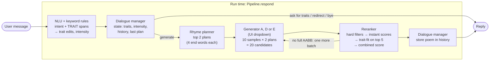
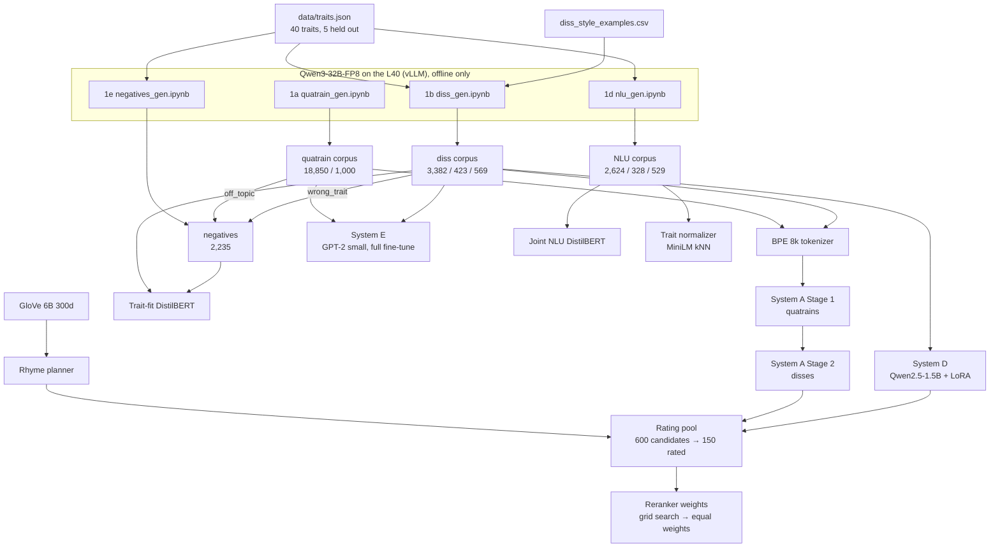
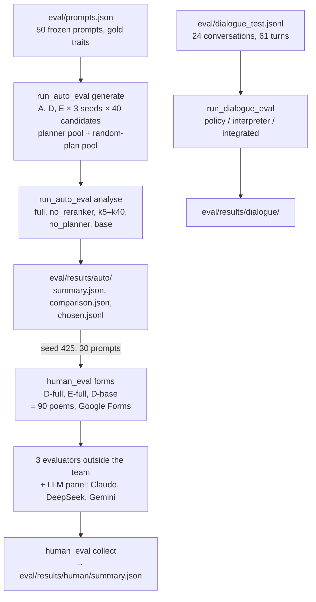

# Architecture and status

How the finished product fits together, and where each piece stands. The design and the full results are in [pipeline.md](pipeline.md); this file maps them to code. Status was checked against the repo on **2026-11-09** (branch `feat/dialogue-integration` at `af0c117`). `python -m unittest discover` runs 108 tests, all passing.

**Legend:** ✅ done · 🟡 partly done · ⬜ not started

Since the previous check (2026-11-07, `d318b88`): the frozen-prompt evaluation over 3 seeds, the integrated dialogue evaluation for D and E, the Qwen interpreter comparison and the human evaluation were all run; `pipeline_gpt2.md` and `project_explained.md` were removed (System E is documented in pipeline.md, Phase 3), and the first prototype moved to `archive/legacy/`. Optional work that was never built (retrieval, Systems B and C, the D size comparison, E's extra variants) is no longer listed here or in pipeline.md; the `retrieval/` folder is an empty placeholder.

---

## 1. The product in one picture

A user chats with the bot, names traits they're proud of, and gets back an AABB quatrain that roasts them. Everything at run time is local (no API calls).



The same chain as text:

```
message ─► NLUInterpreter.interpret ─► DialogueManager.step ─┬─► (no generation) canned reply / question
                                                              └─► RhymePlanner.plan ─► generator ─► Reranker.rerank ─► reply
```

## 2. How the models are built (offline)



Phonetics (`phonetics/`, `data/form_checks.py`) sits under all of this: it filters every dataset, scores candidates in the reranker, and is the main metric in evaluation.

## 3. How it is evaluated



---

## 4. Components

| # | Component | Code | Inputs → outputs | Status |
|---|---|---|---|---|
| 0 | Config, seeds, paths | [config.yaml](config.yaml), [utils.py](utils.py) | | ✅ |
| 0 | Traits | [data/traits.json](data/traits.json) | 40 traits with `description`, `flip`, `synonyms`, `heldout` (eloquent, punctual, patient, worldly, frugal); [data/trait_catalogue.json](data/trait_catalogue.json) adds training counts (`python -m dialogue.build_catalogue`) | ✅ |
| 0 | Frozen eval prompts | [eval/prompts.json](eval/prompts.json) | 50 prompts (single / multi / held-out / unclear) | ✅ |
| 1a | Quatrain corpus | [data/quatrains/](data/quatrains/) | 20,000 generated → 18,850 train / 1,000 val (split by topic group) | ✅ |
| 1b | Diss corpus | [data/disses/](data/disses/) | 4,374 after filters → 3,382 / 423 / 569 (146 held-out in test) | ✅ (manual review skipped by design) |
| 1c | Rhyme-word annotation | in `prepare_*.py` | every diss/quatrain row has `end_words` and `rhymes` | ✅ |
| 1d | NLU data | [data/nlu/](data/nlu/) | 3,481 messages, 7 intents, BIO `TRAIT` | ✅ (spot check needs team confirmation) |
| 1e | Reranker negatives | [data/negatives/](data/negatives/) | 2,235 (flat, non_rhyming, off_topic, wrong_trait) | ✅ |
| 2 | Phonetic module | [phonetics/rhyme.py](phonetics/rhyme.py), [phonetics/scores.py](phonetics/scores.py) | `rhymes`, `aabb_score`, `syllable_score`, `lexical_score`, `form_scores` | ✅ (12 tests) |
| 2 | Rhyme planner | [phonetics/planner.py](phonetics/planner.py) | `plan_rhymes(traits, k, exclude)` → list of `[a1, a2, b1, b2]` | ✅ (fixed version, short common end words) |
| 3 | Tokenizer | [generation/tokenizer/](generation/tokenizer/) | sentencepiece BPE 8k with `<traits> <intensity> <rhymes> <poem> <nl>` | ✅ |
| 3 | System A: GRU LM | [generation/gru_lm.py](generation/gru_lm.py), [sequences.py](generation/sequences.py) | `generate(model, codec, traits, intensity, end_words, n)` | ✅ forward baseline + reversed-line final (`gen_A_rev_stage2_best.pt`) |
| 3 | System D: Qwen2.5-1.5B + LoRA | [generation/qwen_lora.py](generation/qwen_lora.py) | `generate(model, tok, traits, intensity, end_words, n)`; `score(...)` for given poems | ✅ 1.5B (`gen_D_1.5b_best/`); penalty bug in log-probability fixed 2026-11-04 |
| 3 | System E: GPT-2 small + full fine-tune | [generation/gpt2_lm.py](generation/gpt2_lm.py), [train_gpt2.ipynb](generation/train_gpt2.ipynb) | `generate(model, tok, traits, intensity, end_words, n)` | ✅ E-base (`gen_E_base_stage2_best/`); E-poems, E-crpo and Stage 2-only runs compared ([eval/results/gen_E/](eval/results/gen_E/)); 12 tests |
| 5 | Trait-fit classifier | [reranker/trait_fit.py](reranker/trait_fit.py) | `TraitFit.score(traits, poems)` → probabilities | ✅ test AUC 0.984, held-out 0.966 |
| 5 | Combined reranker | [reranker/rerank.py](reranker/rerank.py) | `Reranker().rerank(traits, candidates, history)` → kept candidates, best first | ✅ (history repeat check; 3 tests) |
| 5 | Weight tuning | [reranker/rating_pool.py](reranker/rating_pool.py), [tune_weights.py](reranker/tune_weights.py) | 150 rated candidates → weights | ✅ inconclusive, equal weights kept; rerun after D's log-probabilities were rescored (pipeline.md, Phase 5) |
| 6 | Joint NLU | [nlu/joint_model.py](nlu/joint_model.py) | `NLU.parse(text)` → intent, spans, traits | ✅ intent acc 0.938 |
| 6 | Trait normalizer | [nlu/normalize.py](nlu/normalize.py) | span → trait key / unknown + nearest | ✅ (weakest step: 0.44–0.49 strict on gold spans) |
| 7 | Dialogue manager | [dialogue/manager.py](dialogue/manager.py), [types.py](dialogue/types.py) | `step(turn, state)` → `Decision` + new state | ✅ (61/61 on the gold turns; 20 tests) |
| 7 | Interpreter | [dialogue/interpreter.py](dialogue/interpreter.py) | `NLUInterpreter` (default) or `QwenInterpreter` (comparison): message → validated turn | ✅ NLU 36/61 turns, Qwen 19/61 (2026-11-09), so the NLU stays the default; 14 tests |
| 8 | Pipeline + Gradio UI | [app/pipeline.py](app/pipeline.py), [app/chat.py](app/chat.py) | `Pipeline.respond(message, state, system)`, Gradio Blocks, A / D / E dropdown | ✅ 48/48 roasts for every system; median per turn A 3.3 s (CPU), E 4.0 s and D 13.2 s (GPU), E 22.9 s on the CPU; 19 pipeline tests |
| 8 | Run script + README | [README.md](README.md), [app/setup_assets.py](app/setup_assets.py) | `python -m app.chat --device cuda` | ✅ |
| 9 | Automatic eval on 50 prompts | [eval/run_auto_eval.py](eval/run_auto_eval.py), [auto_metrics.py](eval/auto_metrics.py) | `generate` (candidate pool per system) → `analyse` → `eval/results/auto/summary.json`, `comparison.json`, `chosen.jsonl` | ✅ A, D and E, 3 seeds (2026-11-08); 11 tests |
| 9 | Ablations | [eval/run_auto_eval.py](eval/run_auto_eval.py) | planner, reranker, Stage 1; quality vs. candidates | 🟡 planner, reranker and 1/5/10/20/40 candidates for A, D and E on the frozen prompts; Stage 1 for E, forward vs. reversed for A; no Stage 1 ablation for A |
| 9 | Dialogue eval | [eval/run_dialogue_eval.py](eval/run_dialogue_eval.py), [eval/dialogue_test.jsonl](eval/dialogue_test.jsonl) | 24 conversations / 61 turns → `eval/results/dialogue/` | ✅ NLU with A, D and E (36/61 each; D and E on the GPU, E also on the CPU); Qwen interpreter 19/61 |
| 9 | Human eval | [eval/human_eval.py](eval/human_eval.py), [data/human_eval/](data/human_eval/) | `forms` (Google Forms) → ratings → `collect` → `eval/results/human/summary.json` | ✅ 3 evaluators outside the team, 30 prompts × D-full, E-full, D-base (90 poems), plus 3 LLM judges (Claude, DeepSeek, Gemini; ChatGPT excluded) as a separate panel (2026-11-09); 7 tests |
| 10 | Report and demo | | | ⬜ |

Checkpoints in `checkpoints/` (git-ignored, mirrored to Drive): `gen_A_*`, `gen_A_rev_*`, `gen_D_1.5b_best/`, `gen_E_{poems|crpo|base}_stage{1|2}_best/` (the app loads `gen_E_base_stage2_best/`), `nlu_joint_best/`, `trait_fit_best/`. GloVe files are in `data/glove/` (git-ignored, built by `data/prepare_glove.py`).

---

## 5. Run-time flow in detail

What happens inside `Pipeline.respond(message, state, system)` ([app/pipeline.py](app/pipeline.py)). Design and results are in pipeline.md, Phases 7 and 8.

1. **Control** — exact commands skip the interpreter: "reset", "cancel" and numbered or yes answers to a pending question.
2. **Interpret** — `NLUInterpreter.interpret(message, state)` runs `NLU.parse` and the keyword rules: meaner/softer words before the intent head, missed trait words, remove / replace / generic cues, and a note for a trait guessed by similarity. The result is a `TurnInterpretation`, validated in `dialogue/types.py`. `dialogue.backend: qwen` (or `--backend qwen`) swaps in `QwenInterpreter`, with guards that drop remove/replace edits the message never asked for.
3. **Dialogue manager** — `DialogueManager.step(turn, state)` applies the trait edits and intensity, and either replies (canned / settings), asks (`clarify`, stored in `state.awaiting`) or decides to `generate`.
4. **Rhyme planner** — `RhymePlanner.plan(traits, k=2, exclude=last_plan)` (`reranker.tuning.plans`), falling back to any plan if the exclusion leaves none.
5. **Generator** — the system picked in the UI dropdown (`--system` sets the starting one). 10 samples per plan (`reranker.tuning.per_plan`) at temperature 0.8, top-p 0.9, repetition penalty 1.2, so 20 candidates, each with its length-normalized log-probability. A forces the end words (reversed lines); D and E write forward with end-word tags and nothing forces the end word, so their rhyme depends on the reranker. D runs in `app/model_service.py`, which shares one Qwen model with the Qwen interpreter; A and E load on first use (E from `gpt2.checkpoint` in `config.yaml`).
6. **Reranker** — `Reranker.rerank(traits, candidates, history)`: hard filters (4 lines, Detoxify limits, lexical ≥ 0.8, no exact repeat of `history`), instant features plus the ROUGE-L history penalty, `TraitFit` on the top 5, equal weights.
7. **Reply** — the best full-AABB candidate (`dialogue.require_aabb`). If there is none, one more batch of 20 (`dialogue.generation_retries: 1`), then the best of any rhyme. The guessed-trait note goes above the poem. Only that poem is added to `history`, and its plan becomes `last_plan`.

```python
pipeline = Pipeline(cfg, system="D", device="cuda")    # D is the default; models load on first use
reply, state = pipeline.respond("roast me, I'm confident", pipeline.manager.initial_state())
pipeline.last_trace                                    # stage, interpretation, candidates, survivors, timings
```

---

## 6. Results and what's left

Results so far (details, intervals and tests in pipeline.md, Phase 9, and README.md):

- **Automatic eval** (50 frozen prompts, 3 seeds, 2026-11-08): with the reranker all three systems return a full-AABB poem almost every time (A 100%, D 100%, E 98%). D and E are level on form and on naming the traits (86% and 87%); A trails at 67% and never names a held-out trait. D is slightly closer in meaning to the traits (embedding similarity 0.53 against E's 0.50).
- **Ablations:** the reranker takes full AABB from 74% to 100% for D and from 41% to 98% for E, but raises 4-gram overlap with the training disses by 5 to 7 points. D needs about 5 candidates, E about 20. The planner's contribution is topic: higher embedding similarity for every system, and +21 points of trait mentions for A.
- **Dialogue eval** (61 turns): 36/61 for every generator, since the scored state comes from the NLU and the dialogue manager. Median per turn: A 3.3 s (CPU), E 4.0 s and D 13.2 s (GPU), E 22.9 s on the CPU; D on the CPU was too slow to finish. Without a GPU, A is the demo generator.
- **Qwen interpreter** (2026-11-09): 19/61 turns against the NLU's 36/61, 2/24 conversations against 9/24, and 4.0 s per message on the GPU against 0.02 s. It asks clarifying questions on clear requests (16 times) and is better only on unknown traits (1 of 6 wrongly matched, against the NLU's 6). The NLU stays the default.
- **Human eval** (2026-11-09): three evaluators outside the team rated 90 poems (30 frozen prompts × D-full, E-full, D-base; E replaced A, which the automatic evaluation already separates). People prefer D to E (D-full above E-full on coherence, relevance and poetic quality, Holm p ≤ 0.004) and cannot tell D-full from D-base. Humour is low everywhere (about 2 of 5), and agreement between evaluators is low (alpha −0.26 to 0.23). The LLM panel (Claude, DeepSeek, Gemini) shows the same pattern; ChatGPT's ratings are excluded without changing that.

Still to do:

1. **Report and demo** (Phase 10), including the limits the results show: the planner and reranker improve the automatic measures but not what readers see for D, and humour is low.
2. **Ablation gap:** no Stage 1 ablation for System A.
3. **GPU clock** recorded with GPU latencies (TODO in `eval/run_dialogue_eval.py`).
4. **NLU spot check:** the team confirms `data/nlu/corpus/spot_check.csv` (348 rows marked by Claude only, 42 wrong) before submission.

`archive/` holds files the pipeline no longer uses: the cluster working copies and pilot runs of the LLM data generation (`disses/`, `negatives/`, `nlu/`, `quatrains/`) and, in `legacy/`, the first prototype from before this pipeline (`Datasets/` with the sonnets and the old diss CSV, and its Colab notebook `Train.ipynb`).
